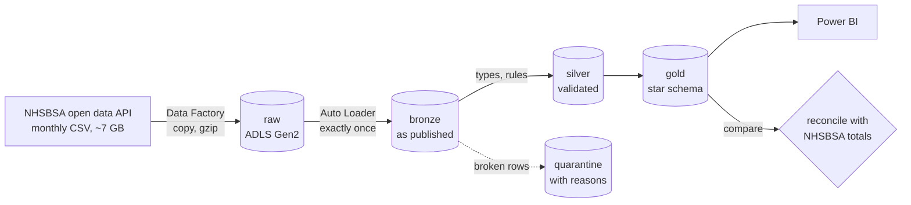
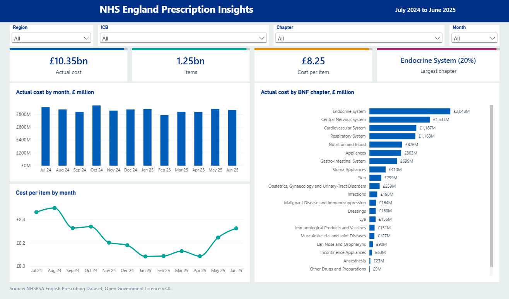
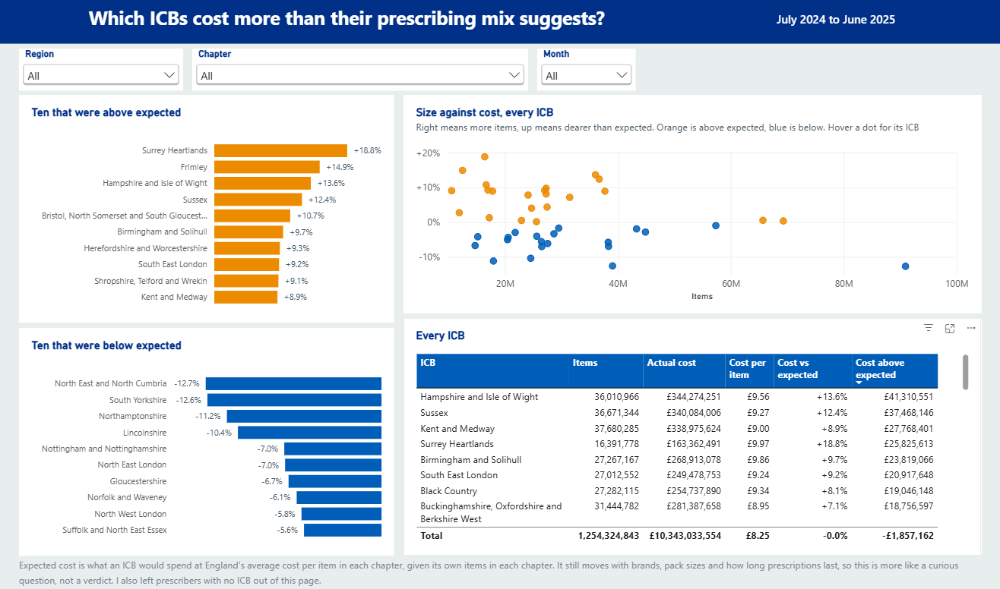
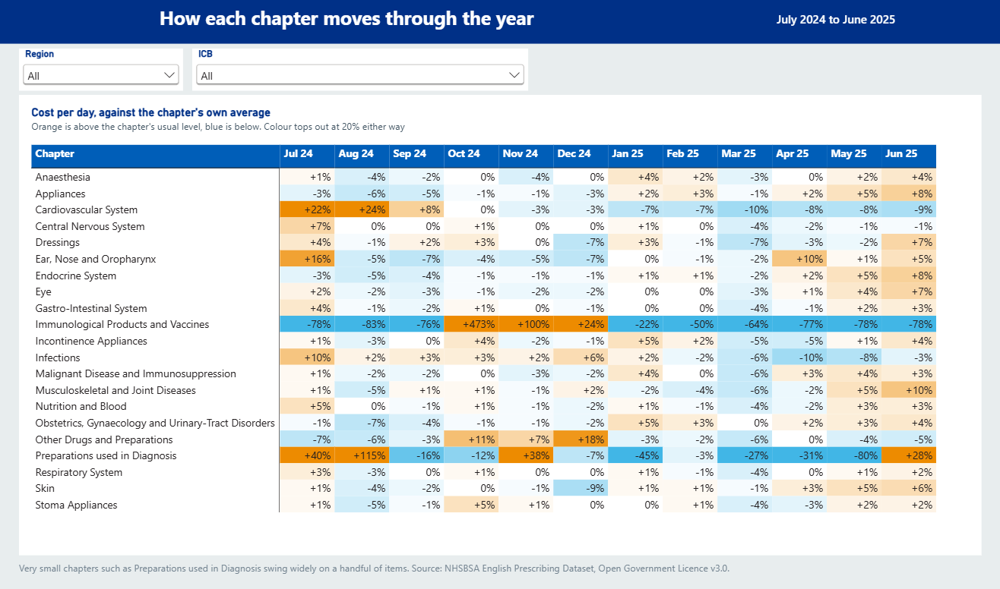
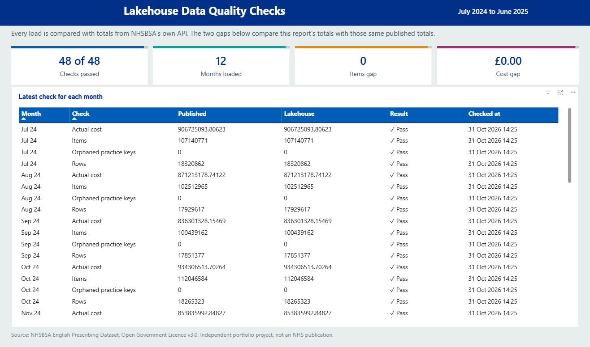

# NHS prescribing lakehouse

A production-style Azure lakehouse for the **English Prescribing Dataset**, every prescription item dispensed in England, published monthly by the NHS Business Services Authority. One month is about 18 million rows and 7 GB of CSV.

Data Factory lands each new month, Databricks moves it through bronze, silver and gold Delta tables, and every load is reconciled against totals computed by the publisher's own API before it counts as done.

> **Status.** Deployed to Azure. Twelve months, July 2024 to June 2025, have run from the publisher's files through to gold, and each one reconciles exactly. That is 216,230,578 rows, 1,254,528,279 items and £10,347,167,629.82, with no rows quarantined and every fact row's practice key present in the dimension. One month takes about 3 minutes to land and about 29 in the Databricks job. A four-page Power BI report reads from gold, and its totals match the publisher's to the penny.

## Architecture



| Layer | Holds | Written by |
|---|---|---|
| raw | Each monthly file exactly as published, gzipped | Data Factory |
| bronze | Every line as text, with source file and arrival time | Auto Loader, once per file |
| silver | Typed, conformed lines that pass every error rule, with any warnings recorded | Silver task, per month |
| quarantine | Lines that broke an error rule, with the rule names | Silver task, per month |
| gold | `fact_prescribing`, `dim_practice` (type 2), `dim_bnf`, `dim_icb`, `dim_period`, `mart_icb_chapter_month` | Gold task |
| ops | `reconciliation`, one row per month and check | Reconcile task |

## What the data turned out to be

Every design decision below came from measuring the live data first, using June 2025 through the publisher's SQL API.

- **18,028,356 rows**, 9,249 prescribers, 21,430 products, 43 ICBs, 103.6 million items, £862.3 million.
- **The grain is not practice and product.** In Bolton, 118,777 lines cover only 64,067 practice and product pairs, because the same medicine appears once for each pack size. A line is unique on month, commissioner, practice, product and quantity per item.
- **26 lines repeat that grain nationally, all from a placeholder prescriber**, code `-`, "UNIDENTIFIED DOCTORS". They are kept, so totals still reconcile, mapped to an "unknown" practice, and summed to the grain in gold.
- **BNF codes are not all 15 characters.** The 1.8 million lines for appliances, dressings and stoma products, chapters 20 to 23, use 11-character codes. That is 10% of rows and £125 million. A small sample of one area missed this, so a run through a real slice of the published file caught it before the first load.
- **Every name field is cut at 40 characters**, so "NHS LANCASHIRE AND SOUTH CUMBRIA INTEGRA" is how one ICB is published. Silver flags these rows rather than guessing the rest.
- **17,854 lines are flagged unidentified**, and their prescribers have no address.

## How it works

**Ingestion (Data Factory).** The pipeline reads the publisher's catalogue API, keeps the months inside a window, and for each one checks whether it has already landed. Only new months are copied, four at a time, gzipped on the way in. A newly published month is picked up on the next run with no configuration change. The pipeline then starts the Databricks job with its own managed identity and polls until it finishes, failing loudly if the job fails.

**Bronze (Auto Loader).** Reads only files it hasn't seen, tracked in a checkpoint, with a declared schema so there is no inference pass over 7 GB. Every field stays text, so a malformed value can never fail the load.

**Silver.** Types every column with `try_cast`, because Spark 4 runs in ANSI mode and a plain cast of a bad value stops the job. Money is `DECIMAL(18,5)`, never float. The BNF code is split into its own hierarchy, from chapter to presentation. Eleven rules decide each row's fate. Error rules send it to quarantine with the reasons, and warning rules keep it and record the issue on the row.

**Gold.** The practice dimension is rebuilt from the full silver history on every run with the gaps-and-islands pattern, which gives the same versions and the same surrogate keys every time, so a rerun or a corrected month can't leave it half-updated. The fact joins each line to the practice version that was valid in its month. Keys come from each version's start month, so loading a month older than those already in gold moves them, and that load rewrites every month of the fact. Newer months rewrite nothing else.

**Reconciliation.** For every month, bronze row count and gold items and cost are compared with the publisher's own totals. Rows and items must match exactly and cost to the penny. Totals can't see a broken join, so every fact row's practice key must also exist in the dimension. Results go to `ops.reconciliation`, and any mismatch fails the job.

**Idempotent by month.** Every write replaces exactly the months it was given, using Delta's `replaceWhere`, and Delta refuses a batch that strays outside them. Running a month twice gives the same tables as running it once. Tests prove both.

## The report

A Power BI Project in [powerbi/](powerbi), so the semantic model and every page are text files in Git. It imports gold through a Databricks SQL warehouse, which runs only during a refresh, so viewing the report costs nothing.



**ICB comparison.** Total cost mostly shows how big an ICB is, and cost per item depends on what it prescribes, so neither says whether an area is expensive. Expected cost does. It is what an ICB would spend at England's average cost per item in each BNF chapter, given its own items in each chapter, and across England it sums exactly to actual cost. Surrey Heartlands sits 18.8% above expected and North East and North Cumbria 12.7% below. In money, Hampshire and Isle of Wight is furthest above at £41 million, and North East and North Cumbria furthest below at £91 million. A gap is a question to ask and not a verdict, because brands, pack sizes and prescription length all still move it, and this lakehouse holds no population data.



**Chapter by month.** Each chapter's cost per day against its own average, so months of different lengths compare fairly. Immunological products and vaccines jump 473% in October 2024, and cardiovascular runs more than 20% above its usual level in July and August 2024.



**Data checks.** The latest reconciliation result for every month, and the gap between this report's own totals and the publisher's. All 48 checks pass, and both gaps are zero.



## Repository

```
infra/        Bicep: storage, Databricks, Data Factory pipeline and trigger, role assignments, budget
src/          the epd_lakehouse package: bronze, silver, gold, scd2, dq rules, reconciliation, io
jobs/         Databricks task entry points, one per layer
tests/        pytest on Spark and Delta, with real NHSBSA rows as fixtures
scripts/      fetch_sample.py pulls a small sample from the API for development
powerbi/      the Power BI Project: semantic model and report as text files
databricks.yml  the Databricks Asset Bundle: job, cluster and wheel
docs/         the runbook
```

## Run the tests

The tests need Spark, so they run in a Linux container that matches Databricks Runtime 17.3 LTS (Spark 4.0, Python 3.12).

```
docker build -f Dockerfile.test -t epd-tests .
docker run --rm epd-tests
```

24 tests cover the silver rules against real and deliberately broken rows, the grain, the placeholder prescriber, type 2 history and its stable keys, point-in-time fact joins, totals surviving every layer, per-month Delta writes and reconciliation.

## Deploy

See [docs/runbook.md](docs/runbook.md). In short, `az deployment group create` with `infra/main.bicep`, then add Data Factory's identity to the workspace and run `databricks bundle deploy`, then redeploy the infrastructure with the job ID so Data Factory can start it.

## Cost

Built for an Azure for Students subscription, so everything that runs is sized and timed to stop. It deploys to Switzerland North because the subscription's region policy rules out UK South, and this public data has no need to stay in the UK. Prices are Azure's Switzerland North list prices in October 2026.

| Item | Price | Notes |
|---|---|---|
| Job cluster, one `Standard_D4ds_v4` node | £0.23 an hour plus Premium jobs compute at £0.23 per DBU hour | Exists only while the job runs |
| Data Factory copy | £0.19 per DIU hour | About four DIU for minutes per month |
| Data Factory orchestration | £0.75 per 1,000 activity runs | Pennies a month |
| ADLS Gen2 hot storage | About £0.016 per GB a month | Raw files move to cool after 30 days |

A budget with alerts at 50%, 80% and a forecast 100% is part of the deployment.

## Data licence

Contains public sector information from the NHS Business Services Authority, licensed under the Open Government Licence v3.0.
